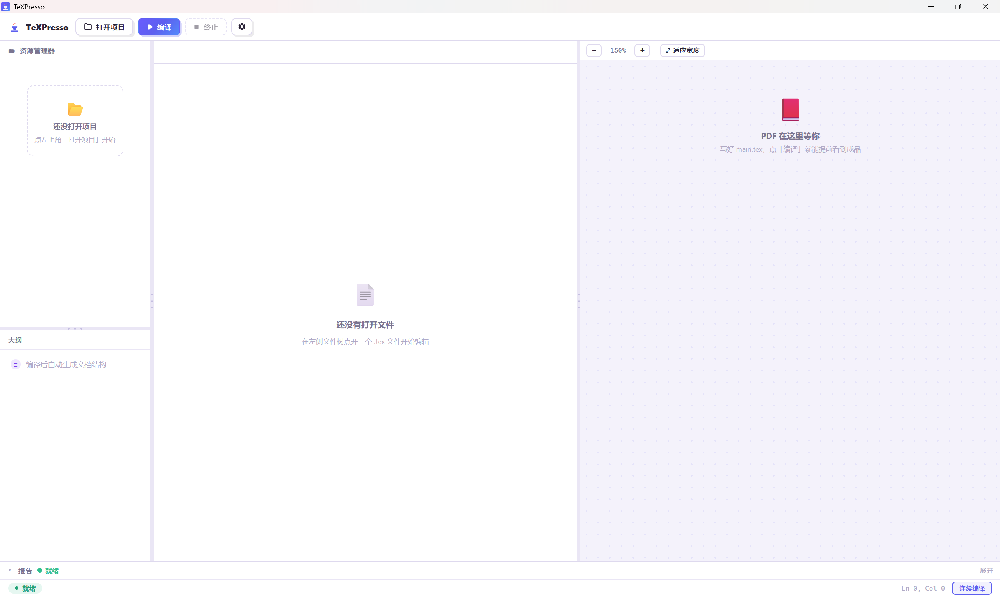

<div align="center">

# Latteset

**一杯拿铁的时间，实时编译出你的 LaTeX 成品**

打开含 `.tex` 的文件夹即可写作：编辑即编译，右侧 PDF 实时更新，并支持源码与 PDF 双向定位。

`Latteset` = **Latte + Typeset**。

</div>

## 界面预览

Latteset 主界面：左侧文件树、中间编辑区、右侧 PDF 预览。



## 安装

依赖 **Windows 10/11**、Node.js ≥ 18、Rust（stable-x86_64-pc-windows-msvc，含 VS Build Tools C++ 工具链）、**vcpkg**（内嵌 Tectonic 的 C 依赖链：六个 `x64-windows-static-release` 端口，入口见下）。

**TeX 环境**：唯一引擎是 **Tectonic**，以**内嵌**形态编进产品进程，**不需要预装 TeX Live / MiKTeX，也不要求 PATH 上有 `tectonic`**。安装包**自带精简宏包集**（517 文件 / 30.43 MiB zip，覆盖论文/幻灯片/中文/图表/参考文献等代表性文档）⇒ **打开即可离线首编**；它**不是完整 TeX Live**，用到覆盖外的宏包时给明确缺包提示，可在「设置 → 引擎 → 宏包集来源」**显式切到在线完整宏包集**或配本地目录 bundle（新版安装包：**NSIS 88.46 MiB / MSI 109.63 MiB**）。引擎不启动外部进程，biber / makeindex / glossaries 不会被自动运行（检出时给状态栏提示，见「实时编译」）；xelatex / lualatex / pdflatex 与 latexmk 驱动已从产品中删除（[ADR-0015](./docs/adr/0015-tectonic-only-embedded-engine.md)）。

构建前置统一由 `scripts/with-tectonic-lib.ps1` 校验（缺项给可执行修复命令）：

```powershell
npm run lib:check                  # 校验 vcpkg / triplet / 六端口 / 工具链
npm install && npm run tauri dev   # 开发构建；发布打包用 npm run tauri build
```

首次启动要编译 Rust（内嵌引擎的 C 链会拉长首编，约几分钟），随后自动打开应用窗口。⚠ 本机若在受限沙箱里跑（工作区带 Low 完整性标签、报 `cl D8050` / `LNK1104`），需先把 `TMP`/`TEMP` 指到工作区内目录——见 [docs/troubleshooting.md](./docs/troubleshooting.md)。

构建与运行细节（vcpkg pin、triplet、环境变量、本机绕法）见 [docs/dev/tectonic-library.md](./docs/dev/tectonic-library.md)。

## 快速开始

1. 启动应用，点「打开项目」，选择一个含 `.tex` 的文件夹（仓库内示例：`test_file/projects/multifile/`，多文件 + 跨文件引用结构）。
2. 编辑 `main.tex` → 自动编译 → 右侧 PDF 实时更新（首次自动「适应宽度」）。
3. `Ctrl+点击` 源码 → PDF 对应位置高亮；点击 PDF → 跳回源码。
4. 点「编译」手动编译；「⚙ 设置」调整编译模式、超时、宏包集来源与缓存目录（引擎固定为内嵌 Tectonic，没有形态选项）。

## 实时编译

- **双模式触发**：**连续编译**（默认，输入停顿约 500ms 即编译，无需保存）+ **保存触发编译**，随时切换；另有手动「编译」按钮。
- **编辑期快速出图**：编辑触发的计算同样走引擎重跑循环，**预算内**收敛就按实际结果报完整档（不亮「引用待更新」）；超出预算才停在草稿态，停手 2s 自动补一次完整收敛把目录/引用页码追上。⚠ 旧的"比完整 latexmk 快约 40%"是 latexmk 时代的读数，那条驱动已删除，**不是** Tectonic 的收益。
- **编译中就有反馈**：状态栏显示「已排版 N 页」——内嵌引擎在**每趟排版收尾**从捕获的 XDV 数完整页，不是子进程 stdout 的 `[N]`；失败后在错误列表给出结构化条目（含诊断；`Overfull` 这类警告留到最终清单）。⚠「错误在编译结束前就出现」的真实提前量未重测。
- **调度与失败语义**：合并队列（待编译只保留最新一条）、超时自动终止（默认 120s、上限 1800s）、手动终止；超时与内容错误都**不自动重试**，超时进错误列表给证据化诊断 + 一键「提高到 Ns 并重试」。取消/超时是**协作式**的（内嵌引擎没有进程可强杀，引擎在下一个 I/O 回调处中止）。
- **错误列表**：解析 `.log`，把原始报错翻译成「原因 + 怎么改」（匹配不到就退回原文 + 行号）；同源去重/截断（错误雪崩不刷屏），点击跳转源码行。

> 说明：驱动层与其它引擎已按 [ADR-0015](./docs/adr/0015-tectonic-only-embedded-engine.md) 删除；历史上 latexmk 的「增量」是对整份文档重跑一遍 xelatex 单遍（不跳过未改动文件）——那条结论保留在 [ADR-0005](./docs/adr/0005-latexmk-first-incremental-next.md)。Tectonic 的收敛由引擎自己完成。外部工具：**内嵌形态不会调用外部 biber**（biber 不随产品分发；需要参考文献时用 `backend=bibtex` 走内建 BibtexEngine，或先在本机自行处理），**makeindex / glossaries 不会自动跑**（索引/术语表为空）；三类都会在检出时给状态栏提示与替代做法，不会静默失败。

## 编辑与预览

- **编辑**：Monaco 编辑器 + 自研 LaTeX Monarch 语法高亮（Candy 配色），环境块折叠、多光标、代码片段（Tab 展开）、错误跳转。
- **预览**：pdf.js 内嵌连续分页（视口感知按需渲染），缩放（±/适应宽度/Ctrl+滚轮），高 DPI 渲染修复。
- **SyncTeX 双向定位**：`Ctrl+点击` 源码 → PDF 高亮；点击 PDF → 跳回源码。

## 项目与设置

- **文件夹即项目**：打开文件夹 → 文件树 → 多标签页；自动保存（防抖）+ 外部修改检测与冲突提示。
- **在软件内管理文档**：文件树支持新建文件/目录、删除（二次确认 + 目录递归）、改名、搜索；空项目里建第一份 `.tex` 时会问一次「文档语言 / 类型 / 标题」（中文 ctex 类或标准类，短文/报告/书/幻灯片），直接生成一份**能编译的最小骨架**，不想要这一步可在「设置 → 编译」里关掉。
- **根文件**：正则启发式自动探测（含 `\documentclass` 的顶层 .tex），可手动覆盖；**还没有根文档**时状态栏给出可点提示，并且每次保存都会静默重探一次——补上 `\documentclass` 保存即成主文件并自动出图。
- **设置**：引擎**固定为内嵌 Tectonic**（不再有引擎下拉/形态选项，`LATTESET_TEX_ENGINES` / `LATTESET_TECTONIC_LIB` 均已删除；旧配置里的 `compile.engine` / `tectonic.lib_form` 会在迁移时被忽略并在状态栏给一次提示，原文件留 `.v1.bak` / `.v2.bak`）、编译模式、防抖、超时、根文件覆盖；全局 + 项目（`.latteset/settings.json`）两层，改即生效。引擎页只剩 **宏包集来源**（内置精简集 / 在线完整 / 本地目录三档）与**缓存目录**两项资源。

## 命令行与 MCP（无 GUI，面向自动化）

GUI 之外，同一套核心也能被脚本与 AI Agent 直接驱动：`crates/latteset-server` 提供 `latteset-cli`（一条命令一个 JSON）与 `latteset-mcp`（MCP over stdio），可完成打开项目、编译并拿到结构化错误与诊断、读写文件、大纲、SyncTeX 双向定位。

```bash
npm run lib:cli                           # 唯一入口（vcpkg 前置 + 环境）；产物在工作区 target/release
latteset-cli --project <项目目录> compile # 默认完整 Tectonic 收敛；--quick 为编辑触发强度（预算内收敛仍如实报 full）。退出码 0=编译通过，1=编译未通过
latteset-mcp --project <项目目录>         # 供 harness / Agent 拉起（stdio）
```

用法、工具清单与限制见 [docs/cli.md](./docs/cli.md)。编译报告里的 `engine` 字段保留、值恒为 `"tectonic"`；`settings` 输出 `schema_version=3`（`tectonic` 只有 `bundle` / `cache_dir`），含 `notices`（一次性提示）。

- **同一项目不要同时用 GUI 和 CLI 编译**：两路内嵌引擎会抢同一个 `tmp/`；约定 headless 独占。

> 开发、设计与路线见 [docs/](./docs/)（导航）、[glossary.md](./docs/glossary.md) 与 [roadmap.md](./docs/roadmap.md)。

## 致谢与思路来源

**Latteset 的若干设计思路，学习自 [TeXPresso](https://github.com/let-def/texpresso) 项目**（作者 [let-def](https://github.com/let-def)，OCaml 实现，改造 XeTeX 做 LaTeX live rendering）——它把"边改边出图"从概念做到了工程级，是本项目最重要的参考对象。

> **更名的起因也是一次善意的提醒**：GitHub 用户 [@mathlab08](https://github.com/mathlab08) 指出了本项目与上游 TeXPresso 的重名问题。**特此感谢**——正因这条提醒才有了 TeXPresso → Latteset 的更名（见 [ADR-0011](./docs/adr/0011-rename-to-latteset.md)）。同名是误会，致敬是本意。

## 许可

[MIT](./LICENSE) © 2026 WenqiBian