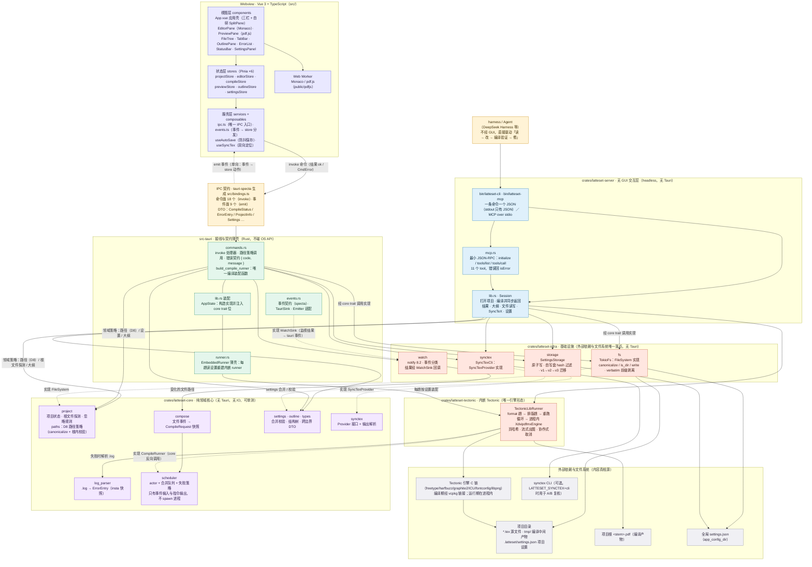
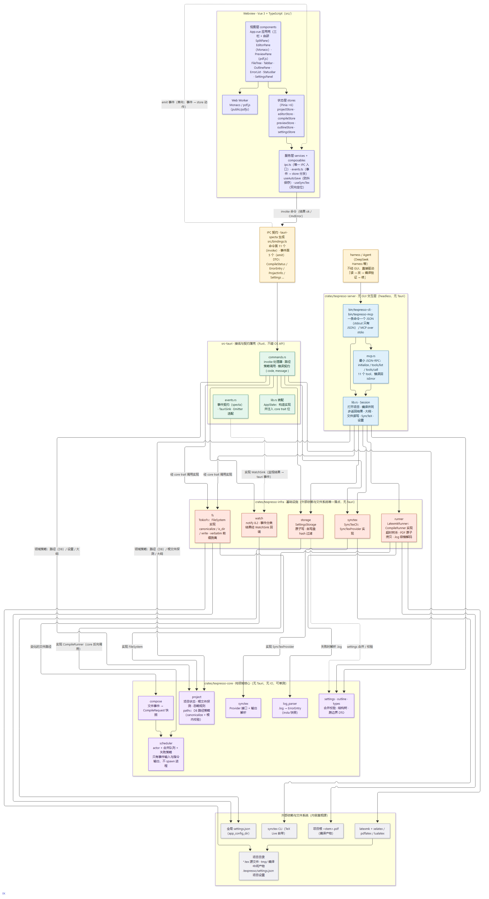
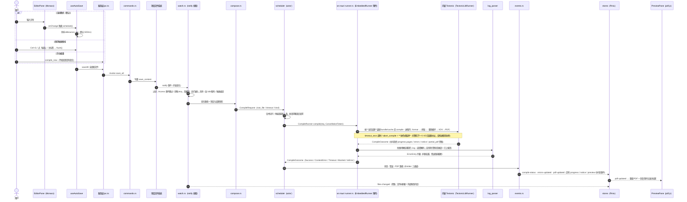
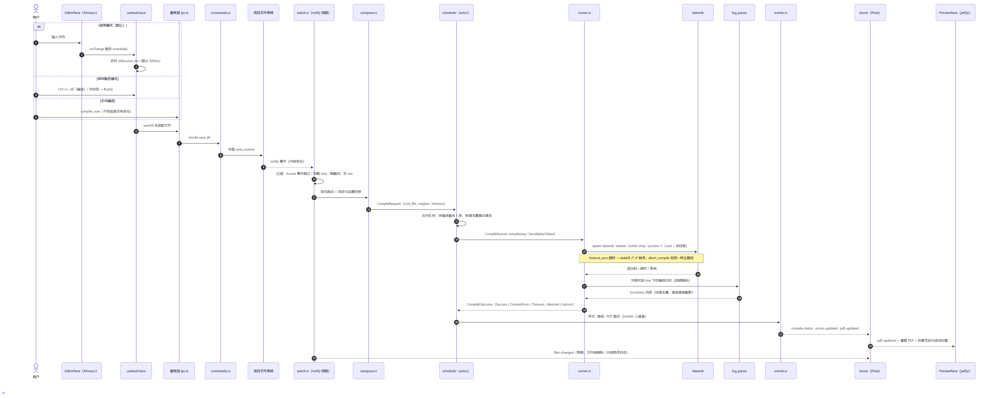
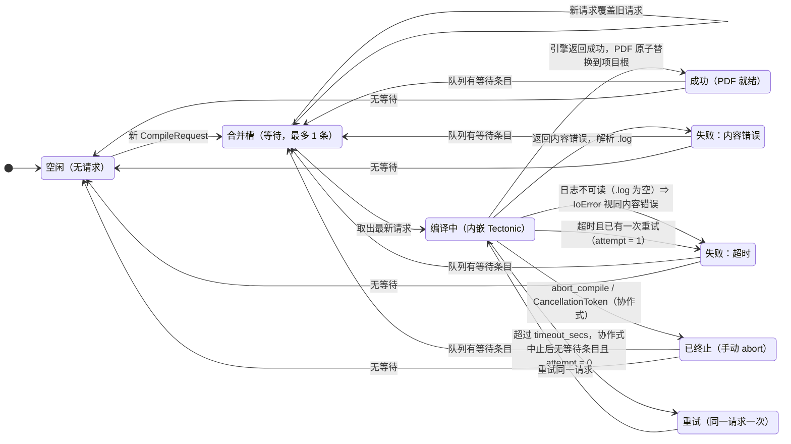
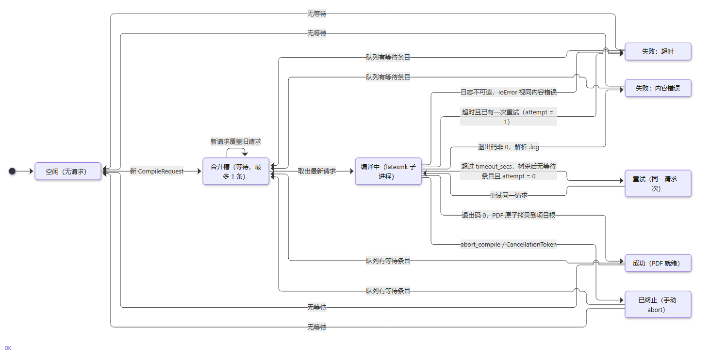
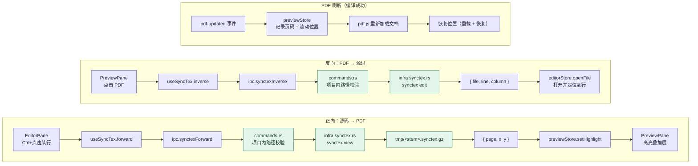
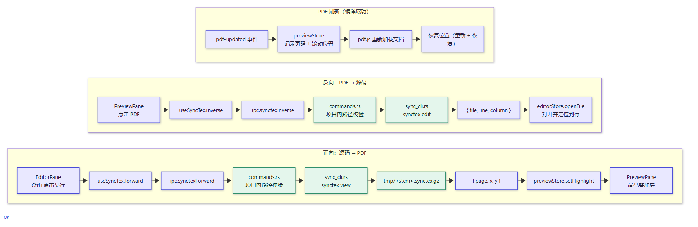

# Latteset 设计文档

> **这是什么、给谁看**：Latteset（`tex-presso`）的产品与架构主文档。前三节定产品语义与子系统行为（实时编译、失败语义、延迟预算、实测口径），第四节定实现结构（分层、模块、IPC 契约、技术栈），第五节内联架构图，第六节定 MVP 边界、分发与质量底线。面向要改这个仓库的开发者/维护者，以及要判断"行为对不对"的评审与验收。
> **配套文档**：术语 [glossary.md](./glossary.md)｜决策记录 [adr/](./adr/)｜未决与后置事项 [roadmap.md](./roadmap.md)｜函数级实现契约 [dev/modules.md](./dev/modules.md)｜测试与验证入口 [dev/testing.md](./dev/testing.md)｜CLI/MCP 用法 [cli.md](./cli.md)｜内嵌 Tectonic 构建/装配 [dev/tectonic-library.md](./dev/tectonic-library.md)｜归档素材（带日期的调研与实测原件）[archive/](./archive/)。

## 目录

1. [产品定位、技术栈与项目模型](#1-产品定位技术栈与项目模型)
2. [编译子系统（核心）](#2-编译子系统核心)
3. [预览、工具链、编辑器与界面主题](#3-预览工具链编辑器与界面主题)
4. [架构](#4-架构)
5. [架构图](#5-架构图)
6. [MVP 边界、分发、测试与质量底线](#6-mvp-边界分发测试与质量底线)

---

## 1. 产品定位、技术栈与项目模型

### 1.1 产品定位

本地运行的 TeX **完整 IDE**（桌面 GUI 应用）。核心设计因素是**实时编译**：文档随用户编辑自动持续编译，无需手动触发。状态：Windows 首发 MVP 已实现并迭代中（项目/编辑/编译调度/错误去重/连续 PDF 预览 + SyncTeX/设置页均可用）。

- 平台优先级：**Windows 首发 → Linux → macOS**
- UI 语言：中文 v1，文案抽离（i18n 结构预留），开源后补英文

### 1.2 技术栈

**Tauri 2**（Rust 后端 + webview 前端：后端负责编译调度与装配，前端负责编辑与展示）· **Vue 3 + TS + Vite** · **Monaco**（编辑器）· **pdf.js**（内嵌 PDF 预览）· **Tectonic**（唯一 TeX 引擎，[ADR-0015](./adr/0015-tectonic-only-embedded-engine.md)：②段已收成**库内嵌唯一形态**，子进程路径已删除）· **texlab LSP**（规划项 v1.1：`\ref`/`\cite` 补全、hover、跳转定义；检测系统安装优先，缺失则首次启动引导下载，存应用数据目录）。

冻结的依赖版本与"明确不引入"清单见 [§4.6](#46-技术栈冻结)。

### 1.3 项目模型

- **文件夹即项目**：打开文件夹 = 打开项目
- **根文件**：自动探测（含 `\documentclass` 的顶层 .tex），可手动覆盖；`\input`/`\include` 指向的文件为子文件
- 多文件项目 v1 支持；**项目内任何非忽略文件的变化都触发编译**（roadmap ㉜）：`.bib`/图片/`.cls`/`.sty` 都是输入。排除 `tmp/`、隐藏项、无扩展名的目录，以及**本次编译自己写在项目根的 `<stem>.pdf`**（不排除会自激）
- **中间文件**（.aux/.log/.toc/.out）→ 项目内 `tmp/` 目录（Tectonic `-o tmp`，由产品 `create_dir_all`；进 .gitignore）
- **PDF 产物** → 项目根目录、与根文件同级（编译成功后从 tmp/ 原子拷贝）
- **配置两层**：全局默认值（用户目录）+ 项目级 `.latteset/settings.json`（可进 git）；项目覆盖全局、逐键合并

## 2. 编译子系统（核心）

### 2.1 触发

- 双模式可切换：**连续编译**（默认，输入停顿防抖 ~500ms 即触发）+ **保存触发编译**；外加手动「编译」按钮（第三种触发）
- **防抖只在前端"保存时机"层**（500ms 是产品语义）；后端不做时间防抖 —— 合并队列（最多一个等待条目）本身吸收事件风暴，后端再加防抖会把延迟撑爆预算；外部工具改文件同样进这条链路（notify 不依赖前端）

### 2.2 调度：合并队列

- 运行中的编译**执行完毕、不中断**；待编译条目**最多一个，总是最新**（合并语义：新请求覆盖旧请求）
- 最大可见延迟 ≈ **2× 完整渲染时间**；已否决"杀旧启新"：反复中断会让渲染迟迟不落地（见 [ADR-0001](./adr/0001-compile-scheduling-and-latency-budget.md)）
- **手动终止** = 停当前 + 清队列；终止后即使 runner 返回其它结果，对外一律呈现为 Aborted

### 2.3 失败语义与超时诊断

| 情形 | 处理 |
|---|---|
| **超时**（单次 >120s，可配置，上限 1800s） | 队列有等待 → 直接执行等待条目；无等待 → **立即失败，不重试**：错误列表给一条证据化诊断（为什么慢 / 疑似卡住 + 怎么办）+ **一键「提高到 Ns 并重试」** |
| **内容错误**（源码问题，进程非零退出） | 不重试；队列有等待 → 直接执行最新版本；无 → 展示错误信息 |
| **手动终止**（用户点停止） | 终止运行中编译 + **清空队列**中的等待条目 |

**超时为什么不重试**：同一份源码在同一个上限下重跑几乎必然再次超时（TeX 运行确定性强），代价却是**再等一个完整超时窗口**——默认 120s 下用户要等 240s 才看到任何提示。所以「重试」不进调度器，而是变成用户可见、可调参的动作：立刻失败 + 证据化诊断 + 一键提高上限。

**超时诊断的证据与判据**（实现契约见 [dev/modules.md](./dev/modules.md) §4.2 / §2.6.1）：条目由 runner 现场采集证据构造（是否首编 / `.tex` 源文件数 / **引擎输出**已排版到第几页）；证据 = `tmp/<stem>.log`（有内容才用）+ **已捕获的 stdout/stderr 尾部** + 流式通道已上报的最大页——Tectonic 的 `.log` 收尾才落盘，被树杀时常常零字节，只读日志会退化成"无页输出"；判据分两类——有页输出 → `compile_timeout`（在推进，只是比上限慢），无任何页输出 → `compile_timeout_stalled`（可能仍在做前置处理，也可能真卡住，**不武断说"卡住"**）；**强判据优先**：证据里已有致命错误就直接报那条且**不给**一键按钮（提高超时救不了）；`suggested_timeout_secs` 阶梯 `300 → 900 → 1800`（**首编直接跳 900**：首编最慢，让用户在注定不够的 300s 上再等一次代价过高），点击按钮的顺序固定为「先改设置、再重跑」。

### 2.4 错误列表与诊断

- 时机：编译中清空 → **编译还没结束就能看见致命错误**（阶段 2 流式反馈；只报致命错误，`Overfull` 这类警告留到终态）→ 失败展示最新完整清单（含警告）→ 点击跳转源码行。⚠ 这条"结束前看见"在 latexmk 时代成立；内嵌形态的中间错误来自引擎状态后端（不是"日志按页 flush"），**提前量 `[未测]`**
- 依据 `.log` 解析（结构化错误提取）；**实时那一路走引擎管道**（stdout 的 `-p` 页标记 + stderr），`tmp/<stem>.log` 尾随只作补充——Tectonic 的 `.log` **收尾才落盘**，编译期间它常常还是空的（见 [dev/modules.md](./dev/modules.md) §2.6.1）；"编译还没结束就报致命错误"的提前量在 Tectonic 下 `[未测]`
- **诊断**：把原始报错翻译成「原因 + 怎么改」——**21 类**（缺包/缺类/缺文件/缺字体/字体集/**需要外部工具的文档**（biber / makeindex / glossaries）/语法与结构类/超时两类/写不出中间文件/宏包与 LaTeX 兜底），**匹配不到则退回原文 + 行号（不猜）**。这是对"错误信息不可读"这一行业最高频痛点的正面回应。`unsupported_tool` 按工具分支给原因：biber →「引擎依赖外部 biber，而内嵌形态不会替你运行」；makeindex / glossaries →「本引擎不会自动运行它，只跳过那一步」
- **不做引擎自动推断**：19 个真实模板双引擎实测中 **0 例**因默认 XeLaTeX 选错，正确替代是"不猜，但选错时明确告诉用户怎么改"（见 [template-corpus-survey.md](./archive/research/template-corpus-survey.md)）。引擎矩阵已按 [ADR-0015](./adr/0015-tectonic-only-embedded-engine.md) 删除 ⇒ **该问题连同"选错"的可能性一起消失**，语料数字保留为**带日期的旧数据**；"不做自动推断"的否决结论不变
- 契约与语料见 [dev/modules.md](./dev/modules.md) §4.1

### 2.5 编译强度：Full / Quick 与产物落点

内嵌形态没有命令行——"两档"是**请求强度**，由 runner 的重跑循环执行：

```
Full（默认）：排版趟 → 比较 rerun 产物（.aux/.toc/.bbl…）→ 有变化就再跑，上限 6 趟 → XDV→PDF
Quick（编辑触发）：同一循环，但受三重预算闸门约束（passes < 3 ∧ 第 1 趟 < 1000 ms ∧ 累计 < 2000 ms）
  —— 预算内收敛就按**实际结果**报 Full（前端 draft=false，不排空闲收敛）；超出预算才停在草稿态
```

- cwd / 输入解析都在进程内完成；`tmp/` 与 `\include` 的子目录由产品自有 I/O 层负责创建（U-14 内嵌形态实测：`tmp/章节/` 等中间目录自动创建；`tmp/` 本身也由产品建）
- 产物：`tmp/<root>.pdf`（原子替换到项目根，失败保留旧 PDF 不被截断）、`tmp/<root>.synctex.gz`（SyncTeX 用）、`tmp/<root>.log`（解析用；内嵌形态边写边在内存里）
- **任何路径都不给 Tectonic 设 `SOURCE_DATE_EPOCH`**（引擎时间源，设 0 会让 `\today` 印成 1970）；库内显式 `build_date(SystemTime::now())`
- `tmp/` 是**合法输入**：重跑时上一趟的中间产物会被预热进内存层，目录/引用不倒退；`\include` 子目录由产品自有 I/O 层保证
- 页哈希：内嵌形态**恒可用**（XDV 在捕获表里）⇒ `pdf-updated` 带 `changed_pages`；空表只表示"无法判定"（XDV 缺失/损坏）⇒ 全量刷新
- 外部工具检出走**成功路径**：`warn!` + `compile-notice`（状态栏提示），不静默降级。**内嵌形态不跑任何外部进程**：biber 不会自动运行（`.run.xml` 请求 biber ⇒ 提示、停在草稿态）；`backend=bibtex` 走内建 BibtexEngine 正常出 `.bbl`；makeindex / glossaries 不会自动跑（索引/术语表为空）

### 2.6 延迟预算（产品约束，验收标准）

- **小文档**（一次完整编译 ≤2s，典型：期刊论文、笔记）：1s 优秀 / 2s 及格
- **大文档**（一次完整编译 >5s，典型：毕业论文、书稿）：3s 优秀 / 5s 及格

> **历史基线声明（§2.7–§2.9、§2.11 的实测数字）**：这些数字全部是 **latexmk / xelatex 时代**（本机 TeX Live 2026）测的。ADR-0015 删除了那三个引擎与 latexmk 驱动，并要求**先测后调**——**内嵌唯一形态的 cold / noop / edit 六档基线仍未重测 `[未测]`**，只有零散点测（阶段② T9：Full 1,200 ms / Quick 75 ms，见 [dev/tectonic-library.md](./dev/tectonic-library.md) §6）。**数字不删**（它们是"为什么这么设计"的证据），但**不得当作当前实现的性能承诺**，也不得用来支撑"内嵌形态已达标"的结论。

### 2.7 延迟预算实测与结构性结论（历史：latexmk/xelatex 时代）

实测（本机 TeX Live 2026，xelatex）：

| 文档 | 冷编译 | 增量(编辑一个文件) |
|---|---|---|
| 小（article，15 行） | 1.53s | 1.50s |
| `multifile`（**单文件前身**，重构前） | 4.06s | 2.02s |
| 重多文件（ctexbook+hyperref+toc+公式，20 章） | 3.74s | 2.29s |

> 上表 `multifile` 行测的是该工程**单文件版**（重构为多文件 + 跨文件引用工程之前），仅供量级参考；现行 `test_file/projects/multifile/` 是 ctexbook + `\include` 组织的 15 页多文件工程，数值见 [§2.8](#28-基准脚本与实测基线)。

**结构性结论（关键）**：latexmk 的"增量" = 对**整份文档**重跑一次 xelatex 单遍；它优化的是"跑几遍"（引用/`\bib` 多次 pass、`\ref` 未变就少跑），**不是跳过未改动文件**。编辑任何子文件都触发整份重排——这是 **xelatex 引擎特性**，自研驱动无法突破。→ **确认暂不过 latexmk**（见 [ADR-0005](./adr/0005-latexmk-first-incremental-next.md)）。

对照预算：中小文档增量 1.5–2.3s，落在"大文档 3s 优秀"线内/附近；小文档接近及格线；**真正大文档（数百页/重图/bib）单遍必然超预算，属引擎上限**。

### 2.8 基准脚本与实测基线（历史：latexmk/xelatex 时代）

**工具**（fixture 不入库，入库的是脚本——`test_file/projects/` 已 gitignore）：

```bash
node scripts/gen-bench-projects.mjs        # 生成六档（纯文本无二进制资产，任意机器可复现）
node scripts/bench.mjs                     # 一条命令出报告；超预算退出码 1
node scripts/bench.mjs --tiers=thesis --samples=5
node scripts/bench.mjs --with-real         # 追加真实模板档（依赖本机 TeX Live 样例）
```

口径严格对齐产品：cwd=项目根、`latexmk -xelatex -outdir=tmp -synctex=1 -interaction=nonstopmode`，不加产品没传的参数；每档 3 次取中位数；先 warm-up 一次排掉文件系统冷缓存与字体缓存。**端到端 = debounce(500) + edit + preview(真机实测值)**。

实测（本机 TeX Live 2026，xelatex，Windows）：

| 档 | 内容 | 冷编译 | 空跑(无改动) | 编辑触发 | 端到端(估) | 判定 |
|---|---|---:|---:|---:|---:|---|
| `tiny` | article 6 行 | 2307ms | 500ms | 1625ms | 2225ms | **FAIL**（小文档 2s 及格） |
| `small-article` | 期刊论文（图表 + bibtex） | 6476ms | 502ms | 2593ms | 3193ms | **FAIL** |
| `multifile` | ctexbook + `\include` 20 章 | 6465ms | 495ms | 2463ms | 3063ms | **FAIL** |
| `graphics` | 30 个 TikZ 图 + 长表 | 2631ms | 499ms | 1826ms | 2426ms | EXCELLENT（大文档预算） |
| `large` | 约 300 页纯文本 | 13532ms | 486ms | 4104ms | 4704ms | PASS（大文档 5s 及格） |
| `thesis` | ctexbook 学位论文（目录/公式/bibtex） | 9412ms | 507ms | 3143ms | 3743ms | PASS |
| `thesis-real-hithesis` | 真实模板样例（可选档，需 `--with-real`） | **>240s 未收敛** | — | — | — | 不计入判定 |

**真机预览（tauri server MCP，同一 `multifile` 档：46 页 / 78KB）**：`fetch 11ms / parse 39ms / render 64ms / total 115ms / pagesRendered=7` ⇒ **真实端到端 = 500 + 2463 + 115 = 3078ms**（脚本用 `--preview=100` 估算 3063ms，偏差 15ms ⇒ 估算口径可用）；render 占预览耗时 **56%**，仍是主因。

**三条结论**：

1. **瓶颈在小文档的固定开销，不在大文档**：`tiny`（6 行）与 `large`（约 300 页）的编辑触发只差 2.5×（1625ms vs 4104ms），而内容量差两个数量级 ⇒ ≈1.5s 的固定开销（latexmk 启动 + xelatex 启动 + 字体加载）在主导小文档；`noop`（latexmk 判定最新、什么都不做）也要 **~0.5s**，这是任何触发的地板。
2. **三档小文档全部超预算**，且按本文的分类口径（"一次完整编译 ≤2s"）本机**已几乎不存在"小文档"**——连 6 行的 `tiny` 冷编译都要 2.3s。→ **预算口径待复核**：放宽小文档预算，还是改为"相对基线/回归容忍度"（例如以 `tiny` 的 1.6s 为地板、其他档按倍数判定）。数据见 [dev/modules.md](./dev/modules.md) §12.1。
3. **真实学位论文远超产品默认超时**：`thesis-real-hithesis` 冷编译 **>240s 未收敛**（另一次观察 >600s），而默认 `compile.timeout_secs = 120` → **必超时失败**（合成 `thesis` 档 9.4s 是"论文规模"的下界，真实模板才是上界）。
   - **该模板的阻塞点不是慢，是报错**：用产品完全相同的命令重跑，它在 ~4 分钟后报 `! I can't write on file 'body/introduction.aux'`（`\include{body/...}` 需要 `tmp/body/` 存在，而它不存在）→ `Emergency stop`，随后 **latexmk/perl 进程挂住（10 分钟零 CPU）**。所以阻塞点是**模板自带 latexmkrc × 本产品 `-outdir=tmp` 约定**（roadmap ㉖）——调高超时也编不过；">240s 未收敛"这条记录**须在 ㉖ 修好后重测**（现状见 [dev/modules.md](./dev/modules.md) §12.1）。
   - **超时上限按真实论文规模放宽**：`compile.timeout_secs` 范围 **5..=1800**（上限 600 是"调到顶也编不过"的死路）。

> 复现性：两轮独立运行的关键档差异 <5%（tiny edit 1617→1625ms、multifile edit 2461→2463ms），脚本可作回归基线。

### 2.9 编辑期单趟（Quick）的收益、代价与落地形态（历史：latexmk/xelatex 时代）

> ⚠ **本节标题里的"单趟"已不是现行实现**：内嵌形态的 Quick 是**请求强度**（走重跑循环 + 三重预算闸门，预算内收敛按实际结果报 Full，见 §2.5 / [dev/modules.md](./dev/modules.md) §2.7）。下面 40.2% 的"省 40%"是 latexmk 外层机制（perl + `.fdb_latexmk`）的收益——那层机制已删除，**不能把这个百分比当作 Tectonic 的收益**；内嵌形态的阶段②点测（Full 1,200 ms / Quick 75 ms）见 [dev/tectonic-library.md](./dev/tectonic-library.md) §6。

`node scripts/bench-single-pass.mjs`（六档 × 3 次、A/B 交替消序）测「完整 latexmk」vs「单趟 xelatex」：

| 档 | 完整 latexmk | 单趟 xelatex | 节省 |
|---|---:|---:|---:|
| `tiny` | 1625ms | 1119ms | 31.1% |
| `small-article` | 2683ms | 1320ms | 50.8% |
| `multifile` | 2437ms | 1761ms | 27.8% |
| `graphics` | 1878ms | 1315ms | 30.0% |
| `large` | 5307ms | 2361ms | 55.5% |
| `thesis` | 3370ms | 1816ms | 46.1% |

**平均 40.2%，6/6 达标 → 值得做**（阈值预设 20%）。

**省在哪（已核实）**：捕获 latexmk 实际命令是 `xelatex -no-pdf … -output-directory="tmp" main.tex` **然后** `xdvipdfmx -E -o "tmp/main.pdf" "tmp/main.xdv"`——它把「LaTeX 趟」与「转换」拆成两个规则，而直接 `xelatex` 一趟内部完成转换。**两者工作量本质相同**，省下的是 **latexmk 外层机制（perl 启动 + `.fdb_latexmk` 依赖库读写）+ 其判断出的收敛趟**。这也解释了上文 `noop ≈ 0.5s` 的地板——纯 latexmk 开销。

**代价（已量化）**：单趟的目录/交叉引用页码**落后一趟**。实测 `multifile` 插 400 行后单趟运行，`.toc` 里「第四章」页码由 **29 → 41**，即该趟 PDF 显示的是旧值 29；再跑一趟 `.toc` 稳定（「单趟旧、两趟收敛」）。

**落地形态**（实现契约见 [dev/modules.md](./dev/modules.md) §2.4 / §2.6 / §9.3）：

- 编辑触发走 `CompileKind::Quick`（内嵌形态的**请求强度**：重跑循环 + 三重预算闸门，§2.5）；首编、手动「编译」、空闲收敛走 `CompileKind::Full`（引擎层收敛，上限 6 趟）
- **强度如实上报**：`Success{kind}` 报**实际**执行结果——Quick 请求在预算内收敛即报 Full（前端 `draft=false`，不亮「引用待更新」，也不会再排一次空闲收敛）；首编没有上一趟产物时同样按预算判定，不虚报草稿态
- **空闲收敛**：成功且为草稿后停手 **2000ms**（任何编辑或新编译都取消）补一次 Full，把目录/交叉引用页码追上；期间状态栏显示琥珀色「引用待更新」，只由下一次成功且为 Full 的编译清除（失败与运行中都不清——屏幕上的 PDF 没变）
- **草稿是"判定结果"而不是固定档**：预算 = 3 趟 / 第 1 趟 <1s / 累计 <2s（末值与前端 2000ms 同值）。超出预算或文档要外部工具（biber/makeindex）时停在草稿态，行为与上面几条原样一致。阶段② T9 实测（热缓存、本地 bundle）：Quick 请求 **75 ms** 且如实报 Full（已收敛）；冷缓存 Full **1,200 ms**（format 974 + 排版 149 + 转换 76）。阈值按发布档标定（debug 构建一趟慢 ≈4.6×，`tauri dev` 下会更早退化——见 [troubleshooting.md](./troubleshooting.md)）
- **编译中反馈**：状态栏显示「已排版 N 页」——内嵌形态在**每趟排版收尾**从捕获的 XDV 数完整页（不是子进程 stdout 的 `[N]`，那路已删除）。⚠ "错误列表在编译结束前就报出"的真实提前量 `[未测]`（内嵌形态的错误来自引擎状态后端；见 [dev/modules.md](./dev/modules.md) §2.6.1）。下面 400KB / 162 页的数字是 latexmk 时代读数
- **页级复用**（[增量编辑 × DVI](./archive/research/incremental-edit-x-dvi.md)）：每次编译后按捕获的 XDV **页哈希**与上一轮比对，把"哪些页变了"随 `pdf-updated` 下发，换来三处复用——**逐页未变则不刷新预览**、**部分变化则只重绘变化页**（实测 74 页文档改末章：render **102ms → 7ms**）、**页哈希全同则跳过 PDF 转换**。内嵌唯一后该能力恒可用（不再有"某形态不可用"）；空表只表示"无法判定"（XDV 缺失/损坏）⇒ 全量刷新。收益都落在"下游重复工作"，不改变排版本身（重排场景仍会命中大量页）
- **真机证据（历史：latexmk 时代）**（tauri server MCP，`multifile`）：一个 cycle 内 就绪 → 排版中 → 就绪 +「引用待更新」→ **Δ≈2.0s** 后再次排版中（收敛的 Full）→ 就绪、提示消失；`tmp/main.fdb_latexmk` 由收敛那一趟更新而 Quick 趟不动它。⚠ 该文件**不再生成**（latexmk 产物），内嵌形态下同类判据改用日志/状态与 `kind` 字段
- **未验证**：biber 场景下编辑期的可用性——内嵌形态**不跑外部 biber**（T9 实测），检出即提示并停在草稿态；`backend=bibtex` 由内建 BibtexEngine 正常出参考文献。详见 §2.4 / [dev/modules.md](./dev/modules.md) §2.7

### 2.10 预览重载实测

**口径**：编辑 → PDF 刷新 ≈ 防抖 500ms + 编译 + pdf.js 重载；`fetch/parse/render/total` 由 `window.__previewLastReload` 插桩读出，其中 `render` = 本次挂载窗口渲染链全部落盘后的**真实 canvas 绘制耗时**（不是 setup 时间）。夹具 `multifile`（31 页 `benchmark`）：

| 场景 | fetch | parse | render | total | 备注 |
|---|---|---|---|---|---|
| `multifile` 同文件重载（3 页 / 108KB） | 9–10ms | 30ms | 59ms | **98–100ms** | 复用 canvas，`pagesRendered=2` |
| `multifile` 首次换文档 | 6ms | 29ms | 77ms | **112ms** | `pagesRendered=3` |
| 31 页 `benchmark` 同文件 | — | — | 21–28ms | **62–69ms** | 对比全量挂载版：render 49ms / total 89ms / `pagesRendered` 9→2 |

- **render 是 PDF 重载开销主因**（占总耗时 ~59%）：视口重绘 + 二次 `renderNearViewport`（分页虚拟化前还含整页 canvas DOM 重建）。分页 DOM 虚拟化把 DOM 节点从 31 降到 ~7 个 canvas（**~4.4× 减少**），同文件内容重载复用 canvas、仅缩放/换文档才重建——契约见 [dev/modules.md](./dev/modules.md) §9.4。31 页那行的 render/total 下降含「渲染页数变少（9→2）」因素，DOM 减量才是无歧义收益
- 3 页文档总耗时 ~100ms 远低于延迟预算；更早一次 12 页 `multifile` 的 `render≈320ms / total≈400–450ms` 是旧插桩数值，与上表不可直接比较
- `test_file/projects/benchmark/` 为基准工程（未提交）

### 2.11 构建确定性（roadmap ㉚）（历史：xelatex 时代；现行口径已反转）

> **现行口径（ADR-0015 / D4）**：产品**不再给 Tectonic 设 `SOURCE_DATE_EPOCH`**——它把该变量当**引擎时间源**，设 0 会让正文 `\today` 印成 1970-01-01。因此：
> 1. 下面"固定 epoch → 逐字节一致"的结论**只适用已删除的 xelatex 路径**；
> 2. **"同一份源码两次编译的 PDF 逐字节相等"不能再作为 Tectonic 档的断言**（内嵌形态的元数据/加密层不可控，见 [dev/tectonic-library.md](./dev/tectonic-library.md) §4.5）；
> 3. `scripts/check-determinism.mjs` 仍驱动 latexmk/xelatex 并注入 epoch ⇒ **与产品现行口径不一致**，只能当历史仪器（跑通与否 `[未测]`，需本机 TeX Live）。

**问题**：TeX 的 PDF 写入器会在 trailer 放一个 `/ID`，其取值与**时钟**有关（PDF 里本来不写 `/CreationDate`）。不处理时"同一份源码编译两次"字节不同，任何基于字节比较的增量渲染都分不清"真改了"还是"ID 抖了"。

**实测（`node scripts/check-determinism.mjs`，三档样本 × 两条编译路径，各连跑两次、间隔 5s）**：

| 场景 | 不固定 `SOURCE_DATE_EPOCH` | 固定 `SOURCE_DATE_EPOCH=0`（现在的默认） |
|---|---|---|
| `multifile` Full（latexmk） | ✗ 不一致（长度 95445 vs 95443） | ✓ 逐字节一致 |
| `multifile` Quick（直调 xelatex） | ✗ 不一致（首差 @92143，共 67 字节） | ✓ 逐字节一致 |
| `beamer工程` / `bench/thesis` × 两条路径 | ✗ 不一致 | ✓ 逐字节一致 |

**结论与副作用（都已实测）**：runner 给两条编译路径都注入 `SOURCE_DATE_EPOCH=0` 后，六个组合全部逐字节一致；该变量**不影响 XeTeX 的 `\today`**（`\typeout{TODAYMARK=\today}` 仍打印构建当天日期），也**不会**让 PDF 多出 `/CreationDate`——所以固定 epoch 只掐掉 `/ID` 的时钟抖动，不污染用户文档的日期语义。

**边界**：文档**内容**里含日期（`\date{\today}`）时，跨天编译字节当然会变——那是内容变了，不是构建不确定性。

**按引擎分档**（D4 裁决）：Tectonic **不设**该变量（它把变量当引擎时间源，设 0 会让正文 `\today` 印成 1970-01-01）；其余引擎仍固定 0。

## 3. 预览、工具链、编辑器与界面主题

### 3.1 预览

- **内嵌 PDF 面板**（pdf.js）：编译成功后自动刷新、保持滚动位置（v1 必须）。滚动保持用"重载 + 恢复位置"而非局部更新（pdf.js 无增量渲染 API）
- **SyncTeX 双向**（v1）：源码 Ctrl+点击 → PDF 高亮；PDF 点击 → 跳回源码
  - **只跳真实源码**：`synctex edit` 在生成内容上会返回生成它的中间文件（实测点目录区得 `tmp/main.toc:15`）。产品行为：**不打开生成文件**，先在附近小范围探测（y ±40/80pt）**回落到最近的真实源码**并提示"已回落"；仍无源码则忽略跳转、只提示（"此处来自自动生成的文件 main.toc…"）。项目外文件（`article.cls` 等）同理给提示。命令层策略与纯函数分类见 [dev/modules.md](./dev/modules.md) §5
  - **同步提示可见**：反向/正向失败、以及"没有可跳转源码"都在预览工具条给一句提示（5s 自动消失）——否则用户看到的是"点了没反应"（错误只在 `console.error` 里）
  - **竞争重试**：编译进行中 `.synctex.gz` 正被重写（引擎先写 `main.synctex(busy)` 再改名），失败按 100/200/300ms 退避重试；退避只给瞬时错误，确定性失败（同步数据不存在 / 没有这段映射）立刻返回
  - **实测精度（`node scripts/synctex-report.mjs`，三组样本 34 个样本点）**：正向 **34/34**、反向 **34/34**、往返同文件 **34/34**；往返行号差 ≤3 行 **31/34（91.2%）**、≤5 行 **34/34**。分档：`large`（125 页）差恒为 **0**、`multifile` **0–1 行**、`beamer` **2–4 行**（帧边界 `\begin{frame}`/`\label` 处最松）。**取块启发式已排除**：first / 最小 H / "文本行"三种取块规则给出**完全相同**的往返结果 → 保留"取第一个完整块"，beamer 的 2–4 行偏移是 beamer 记录粒度的固有现象。⚠ **口径限制（2026-11 验收补充）**：这组"反向 34/34"是**往返**（用正向给出的坐标回查），**不是任意点反向**。任意点在"页尾命令行 / 跨文件页"上会退化到页尾行号、跨文件页还可能指错文件（`LATTESET_SYNCTEX=cli` 在同数据上正确；`xelatex` 产物同样复现 ⇒ **预存缺陷**，已登记 [dev/modules.md](./dev/modules.md) §12.1 #29）。所以**正向与 CLI 一致；反向在跨文件页有已知精度缺陷**
- **草案层 · 实时预览 v1**：**左边输入 → 右边 ~30ms 内看到"改动那一行"的近似重绘**（目标 ≤200ms）；真正的正确排版仍由下一次编译的 `pdf-updated` 覆盖
  - 口径：**允许不精确**。用"上次成功编译建立的 PDF 文本行索引"定位改动行 → 该页 overlay 上**白底重绘这一行**（带草稿下划线，明确提示"这是近似预览"）；**找不到锚点就静默不画**（不阻塞输入、不报错）。渲染契约与 v1 限制见 [dev/modules.md](./dev/modules.md) §9.4
  - **显示的是"排版结果的样子"，不是源码**：改动行先经 `latexToDraftText()` 近似——去数学定界符/环境/标签，`\frac{a}{b}`→`(a)/(b)`、`\sqrt{x}`→`√x`、希腊字母与算符→Unicode、上下标尽量映射；**纯标记行（如 `\end{equation}`）不画**，而不是把 `$E = mc^2$` 这种代码糊在预览上
  - 实测（28 页中文夹具、索引 594 行）：改动→草案可见 **31–34 ms**（含 30ms 去抖）；索引构建 **164–173 ms**（编译成功后后台做，不阻塞）。成本结构（引擎地板 / PDF 后端 / 草案层取数）见 [realtime-preview-cost.md](./archive/research/realtime-preview-cost.md)
- **编译中预览（部分 PDF）**：内嵌形态在编译期把**已完成页**缝成部分 PDF（`tmp/<stem>.preview.pdf`，原子替换）交预览；工具条「编译中预览 · N 页」只在真的收到帧时出现。中间态**不得**喂页哈希缓存 / 跳过转换闸门 / 权威 `pdf-updated`。内嵌唯一后该能力**恒可用**（XDV 在捕获表里才能合成部分 PDF；不再有"另一形态没有"的口径）
- **外部 PDF 查看器支持**：后续版本

### 3.2 工具链

- **唯一引擎 = Tectonic、唯一形态 = 内嵌**（[ADR-0015](./adr/0015-tectonic-only-embedded-engine.md) 决策 2 已在②段执行）：xelatex / lualatex / pdflatex 与 latexmk 驱动已从产品中删除，子进程 `tectonic.exe` 路径也已删除——**不需要用户预装 TeX Live / MiKTeX，也不要求 PATH 上有 `tectonic`**。代价：**所有构建都需要 vcpkg**（`latteset-tectonic` 是 `src-tauri` / `latteset-server` 的非可选依赖），入口与前置见 [dev/tectonic-library.md](./dev/tectonic-library.md) §2。
- **能力边界照单接受、不回退**（ADR-0015 第 4 条）：**内嵌形态不跑任何外部进程**——**biber 不会被自动运行**（T9 实测：PATH 上有真 biber 也不跑、不产 `.bbl`；`backend=bibtex` 走内建 BibtexEngine 出 `.bbl`）、**makeindex / glossaries 不会自动跑**（索引/术语表为空）；依赖模板 `latexmkrc` 的构建约定失效。检出即诊断 + `compile-notice`（状态栏提示），**不静默降级、不自动切回别的工作流**。

**内嵌 Tectonic**（唯一形态，`crates/latteset-tectonic/`；实现契约见 [dev/modules.md](./dev/modules.md) §2.7、构建/装配见 [dev/tectonic-library.md](./dev/tectonic-library.md)）

- 把 Tectonic 引擎 crate 直接嵌进产品进程——自持 `IoProvider`（内存直喂输入 + 输出捕获 + format 自管）→ `CoreBridgeLauncher` → `TexEngine`（format 自管 → 排版）→ `XdvipdfmxEngine::process`。方案与裁决 = [tectonic-library-plan.md](./archive/tectonic-library-plan.md) §3.4、[ADR-0012](./adr/0012-tectonic-library-form-engine.md)。
- **装配与热生效**：GUI 的 `EmbeddedRunner` 是约 30 行薄壳，**每趟编译读一次全局设置**的 bundle / cache 后重建 `TectonicLibRunner` ⇒ 资源设置改完即生效、不需重启（D1）；headless 的 `build_runner` 读 `Session.settings.tectonic`（D4）。两处优先序一致：**显式设置 > 环境变量 > 宿主默认**。
- **bundle 与缓存**：`network-bundle` 特性已在两个上层 manifest 打开 ⇒ `bundle = null` 时走**上游网络地址（首次联网取包）**；本地**目录 bundle** 写 `file:///E:/...` 或相对路径（**绝对 Windows 路径 `E:\...` 会被上游当 URL scheme 吃掉**），目录必须自带 `SHA256SUM`。缓存 `<cache>/formats` 存 format、`<cache>/bundles` 存 bundle，**必须显式注入**——上游 format 默认落**项目目录**（~24 MB 的 `.fmt` 会扔进用户项目）。完整 bundle ≈ **2.88 GB** ⇒ 随包不可行、**待③段前重定**（ADR-0016「实测修正」）。
- **能力面（全部恒可用）**：`Full` 请求跑**重跑循环**（跑到 `.aux`/`.toc`/`.bbl` 稳定，上限 6 趟）并做 **bib 趟**（`.aux` 含 `\bibdata` ⇒ 内建 `BibtexEngine` ⇒ 再排版，引用解析成编号）；**页哈希**由捕获表里的 XDV 喂 `latteset_core::xdv::page_hashes`（缓存名固定 `tmp/<stem>.tectonic.pages`）⇒ **A/B/C 页级复用恒可用**；**编译中预览**（趟边界部分 PDF）恒可用。biber / makeindex / glossaries 不跑（见上）。
- **失败不回退**：内嵌唯一后没有"另一个形态"可回退；bundle/缓存配置错误走 runner 的显式失败文案。**取消是协作式的**（C 层 abort/panic 不可树杀，引擎在下一个 `IoProvider` 回调处中止，X-3）——取消延迟必须如实写进 UI 语义。
- **实测（阶段② T9，2026-11-20；证据 `test_file/phase2/REPORT-gates.md`）**：U-14 中文目录 + 中文子目录 `\include` exit 0、694 ms、3 页、0 个 U+FFFD；冷缓存 Full **1,200 ms**（format 974 + 排版 149 + 转换 76）、热缓存 Quick 请求 **75 ms**（已收敛 ⇒ 如实报 `full`）；内容错误精确归属 `chapters/ch1.tex:3`；biber/bibtex 对照见上。⚠ **比性能必须 `--release`**（`dev` profile 下 C 引擎 `-O0`，同夹具数字大 6–8×）。
- **模板与旧工具约定**：**㉗（源码版模板 `.ins`/`.dtx` 提示）语义保留**（D7：搬进内嵌失败路径）；**㉖（latexmkrc 中和）不适用**——没有 latexmk 了；**㉝/G1 的 `.fls`/`.fdb_latexmk` 依赖记录不适用**（latexmk 产物，不再生成）；**㉒（生成产物永不当作源码打开）仍适用**——SyncTeX 自解析 + 回落策略照旧。
- 未做（P1）：~~一键切引擎（INT-90/95/96）~~（引擎矩阵已删除，ADR-0015）、`-b <ttb>` 离线 bundle（随包方向见 ADR-0016）、bib 警告过滤（INT-43）。逐条判据见 [tectonic-test-plan.md](./archive/research/tectonic-test-plan.md)。

### 3.3 编辑器

- **v1（已实现）**：语法高亮（自研 Monarch）、查找替换、错误跳转、**中文 IME 兼容验证**（Windows 首发，webview 组合输入是已知坑，实操要点见 [troubleshooting.md](./troubleshooting.md)）
  - **非 UTF-8 源文件**（roadmap ㉓）：打开时**明确拒绝并给中文提示**（"用记事本/VS Code 另存为 UTF-8…"），状态栏红色提示条显示，不开标签页。**不做 lossy 打开**：编辑器保存会把替换字符写回磁盘，等于静默损坏用户文件
- **语言特性（已实现）**：环境块折叠（`\begin{env}`/`\end{env}`，含嵌套）、多光标（Alt+点击/Alt+方向，Ctrl+D 加选；修饰符用 alt 以免与 SyncTeX 的 Ctrl+点击冲突）、代码片段（LaTeX CompletionItemProvider，覆盖文档骨架/环境/章节/数学/格式/文件操作，Tab 展开）。解析与折叠语义见 [dev/modules.md](./dev/modules.md) §9.5
- **v1.1（规划）**：texlab LSP、拼写检查

### 3.4 界面主题：Candy Desk 深浅两套

**结构**：token 两层 —— **通道变量** + **角色 token**，都由 `src/App.vue` 的 `:root` 定义，深色块是 `[data-theme="dark"]` 覆盖（同一处）。

| 层 | 例子 | 为什么这么分 |
|---|---|---|
| 通道变量 | `--blueberry-rgb: 93, 95, 239` | 站点自己拼 alpha（`rgba(var(--blueberry-rgb), 0.10)`）⇒ **浅色每个 alpha 逐字保留**，深色只改一处通道值就整片生效（不用逐个站点改 alpha） |
| 角色 token | `--danger-ink` / `--on-accent` / `--select` | "强调色当文本/描边"在深浅两态**必须换值**（浅色压暗、深色提亮），跟通道无关 |

**深色四条规则**（改配色时别破坏）：① **色相不能丢** —— 纸面用墨紫罗兰 `#16131f`（与浅色 `#f4f2fb` 同色系），不用中性灰/纯黑；② **抬升方向不变** —— 浅色下卡片比纸亮，深色下卡片仍比纸亮一档（"纸"→"墨"，关系没变）；③ **糖果色提亮** —— 深底上要发光；④ **硬阴影翻成暗投影** —— 浅色下 3px 硬偏移是"纸片翘起"，深色若还取亮色会变成光晕（语义反了），故 `--shadow-rgb` 单独一根，深色取黑（硬边这个签名保留）。

**对比度实测**（深色，`getComputedStyle` 取值算 WCAG 比值）：正文 `--ink/--paper` **15.3:1**、次级 **7.1:1**、三级（提示/占位）**4.4:1**、错误文字 **8.3:1**、警告 **10.9:1**、成功 **9.2:1**、主色当文本 **5.8:1**。
> 主按钮/选中分段是"实底强调 + 白字"：浅色下蓝莓底够深没问题；深色把蓝莓提亮后白字只剩 **2.4:1** ⇒ 引入 `--on-accent`（浅色白、深色墨色 `#16131f`），修后 **6.3:1**。这是深色主题唯一必须"反转"的一对。

**PDF 预览不做反色**：页面保持纸白（阅读保真优先——图表/图片反色会失真、字体渲染也会变怪），只把周边 chrome 压暗。白页在深色外壳里是**有意的"台灯下的纸"**，不是漏改。

**落地链路**：设置 `ui.theme = light | dark | system`（全局设置，Rust 侧 model/merge/specta 绑定，**默认 light**：深色是新能力，默认值必须让既有用户升级后外观不变）→ 前端 `src/composables/useTheme.ts` 解析（`system` 读 `prefers-color-scheme` 并监听变化）→ 写 `<html data-theme>` + `localStorage` + Monaco 主题 → `index.html` 的内联脚本在**首帧前**用 `localStorage` 定主题（否则深色用户每次启动先闪一下白屏）。Monaco 有独立一份主题定义（`src/monacoTheme.ts`）：它只吃具体色值、不参与 CSS 变量求值，所以是"token 的第二落点"，改糖果色要两处一起改。

## 4. 架构

本节定**实现结构**（分层、模块、接口、技术栈）；§1–§3 定产品语义与子系统行为。函数级契约、已知债与验证入口见 [dev/modules.md](./dev/modules.md)。

### 4.1 分层总览

非对称分层，依赖方向严格单向（图示版见 [§5.1](#51-分层与依赖总览)）：

```
前端（Vue 3 + TS：components → stores → services，只有 services 碰 IPC）
  → IPC 契约（specta 生成的 TS 类型）
  → src-tauri（commands：DTO 转换 / 事件发射 / 装配注入，无业务逻辑）
  → latteset-infra（进程、文件、监视、设置存储；外部依赖与文件系统的唯一落点，无 Tauri）
  → latteset-core（队列语义、探测规则、解析；纯逻辑，定义接口与策略，不依赖 infra）
第二条入口：CLI / MCP → latteset-server → latteset-infra → latteset-core（不碰 Tauri / 不碰 OS API）
```

原则：

- 依赖单向：`前端 → IPC 契约 → src-tauri → latteset-infra → latteset-core`（接口在 core、实现在 infra、注入在 src-tauri；[ADR-0010](./adr/0010-infra-crate-boundary.md)）。**第二条入口**：`CLI / MCP → latteset-server → latteset-infra → latteset-core`（同样不碰 Tauri）
- 上层（src-tauri）不直接调用 OS API：文件与进程一律经 core trait，路径安全策略（D8）在 core `project::paths`
- 领域层不依赖 Tauri、不做 IO；IO 经基础设施，测试经 trait 注入
- 不做 ports & adapters 式 trait 泛滥；只有真正需要替换/注入的边界才抽象（CompileRunner、SyncTexProvider）

### 4.2 Rust 侧：workspace 与模块

Cargo workspace **五 crate**：[ADR-0006](./adr/0006-workspace-split-core-and-tauri.md) 拆出 core，[ADR-0010](./adr/0010-infra-crate-boundary.md) 再拆出 infra（基础设施层与 core 同级）；⑥ 新增 headless 交互层 server（与 src-tauri 同级，两条入口共用 core + infra）；⑫ 新增 **latteset-tectonic**——②段起它是**唯一引擎形态**的承载 crate（`src-tauri` / `latteset-server` 的非可选依赖，所有构建都需要 vcpkg；不再由 `default-members` 排除，见 [dev/tectonic-library.md](./dev/tectonic-library.md)）。

**latteset-core**（无 Tauri 依赖、无 IO，全量可单测）

| 模块 | 职责 |
|---|---|
| `scheduler` | 合并队列 + 超时/重试/终止语义状态机。**只有事件输入与指令输出，不 spawn 进程**；经 `CompileRunner` trait 执行编译（单测用 fake runner） |
| `project` | 项目模型、根文件探测规则、文件集合过滤 |
| `log_parser` | .log 解析 → ErrorEntry（快照测试） |
| `synctex` | `SyncTexProvider` 接口 + 输出解析（进程调用在 latteset-infra） |
| `settings` | 设置模型、默认值、全局/项目合并、校验 |
| `compose` | 组合层翻译：文件事件/手动编译 → `CompileRequest`（D3，infra watch 调用） |
| `paths` | 项目内路径解析（D8）：canonicalize + 根内校验 + `PathError`（IO 经 FileSystem） |
| `types` | 跨边界 DTO（CompileStatus / ErrorEntry / ProjectInfo / Settings…，specta 导出） |

**latteset-infra**（基础设施层：外部依赖与文件系统的唯一落点，[ADR-0010](./adr/0010-infra-crate-boundary.md)）

| 模块 | 职责 |
|---|---|
| `fs` | `tokio::fs` 实现 `FileSystem`（含 canonicalize / is_dir / write）；Windows `\\?\` verbatim 前缀剥离 |
| `synctex` | SyncTeX 输出解析（实现 SyncTexProvider）：**默认进程内自解析**（[ADR-0013](./adr/0013-synctex-in-process-parser.md)）；系统 CLI 仅在 `LATTESET_SYNCTEX=cli` 时作 A/B 复核备选（[ADR-0008](./adr/0008-synctex-via-cli-with-interface.md) 的预留替换路径） |
| `proc` | 起外部进程的原语（Windows `CREATE_NO_WINDOW`）——现只剩 SyncTeX CLI 使用它；编译不再 spawn 进程 |
| `storage` | 设置存储：全局/项目文件原子写 + 自写盘 hash 过滤；v1 → v2 → v3 迁移（备份 `.v1.bak` / `.v2.bak`） |
| `watch` | notify 8.2 直连（不用 tauri-plugin-fs 的 JS watch）：事件分类 → 调度器输入 / 设置热更新；结果经 `WatchSink` 回调（本层不认识 Tauri） |

> 子进程 runner（`runner.rs`）与 bundle 获取/缓存判定（`tectonic/`）已在②段**整文件删除**（ADR-0015 决策 2），理由见 [dev/modules.md](./dev/modules.md) §2.6。

**latteset-tectonic**（内嵌 Tectonic = 唯一引擎形态，[ADR-0012](./adr/0012-tectonic-library-form-engine.md) / [ADR-0015](./adr/0015-tectonic-only-embedded-engine.md) / [dev/tectonic-library.md](./dev/tectonic-library.md)）

| 模块 | 职责 |
|---|---|
| `runner` | `TectonicLibRunner`（`CompileRunner` 实现）：format 趟 → 排版趟 → 重跑/收敛循环 → 进程内 `XdvipdfmxEngine` → PDF 原子替换；页哈希、流式出图、失败面见 [dev/modules.md](./dev/modules.md) §2.7 |
| `io` / `status` / `bundle` / `synctex` | `IoProvider` 实现（内存直喂 + 输出捕获）、引擎状态回调（中间态错误）、bundle 检测、主输入名补丁 |

**src-tauri**（接线与契约薄壳）

| 模块 | 职责 |
|---|---|
| `commands` | invoke 处理器：DTO 转换、路径策略调用、错误契约 `{ code, message }`；无业务逻辑。`build_compile_runner` 是唯一装配函数（主编译 + 公式预览共用） |
| `runner` | `EmbeddedRunner` 薄壳：每趟编译读设置里的 bundle/cache 重建 `TectonicLibRunner`（资源改动即生效） |
| `events` | 事件契约（specta 生成）+ `TauriSink`（监视结果 → tauri 事件）+ 调度器 Emitter 适配 |
| `lib` | 装配：构造 infra 实现注入 core trait 位；持有 AppState（调度器、设置、项目状态） |

**latteset-server**（无 GUI 交互层：headless 服务 + CLI + MCP，roadmap ⑥）

| 模块 | 职责 |
|---|---|
| `lib` | `Session`：项目会话（打开项目、编译并同步返回结果、大纲、文件读写、SyncTeX、设置读取）；直接实例化 infra 的 fs/runner/synctex/storage，不经 scheduler、无 watch、无 Tauri |
| `mcp` | MCP over stdio：手写最小 JSON-RPC（initialize / tools/list / tools/call / ping），11 个 tool；工具内错误回 `isError: true` |
| `bin/latteset-cli` | 一条命令一个 JSON（stdout 只有 JSON，日志走 stderr）；退出码：0 成功 / 1 编译未通过 / 2 用法·路径 / 3 内部 |
| `bin/latteset-mcp` | 常驻 stdio server（harness 侧本地拉起） |

契约与限制见 [dev/modules.md](./dev/modules.md) §8.1，用法见 [cli.md](./cli.md)。

### 4.3 前端侧：模块划分

- **services**：`ipc.ts`（specta 生成的类型化 invoke 封装）、`events.ts`（事件订阅 → store 分发）
- **stores（Pinia ×6）**：projectStore（项目/根文件/文件树）｜editorStore（打开文件、脏标志、活动标签）｜compileStore（编译状态/队列/错误列表）｜previewStore（PDF 文档、滚动位置、SyncTeX 高亮）｜outlineStore（源码结构树）｜settingsStore
- **组件**：EditorPane（Monaco 封装）、PreviewPane（pdf.js 封装）、FileTree、TabBar、OutlinePane（大纲）、ErrorList、StatusBar、布局壳、**自研 splitter**（不引入 vue-code-layout，多面板布局后置）
- **composables**：useAutoSave（防抖保存）、useSyncTex、useTheme、useIdleConvergence

函数级职责、状态与不变量见 [dev/modules.md](./dev/modules.md) §9。

### 4.4 层间接口契约（IPC）

类型安全：**tauri-specta**（锁定 RC 版本，如 rc.25），命令签名与事件载荷从 Rust 自动生成 TS 类型。

**命令面（invoke）**

| 命令 | 输入 | 输出 |
|---|---|---|
| open_project | folder | ProjectInfo（含根文件探测结果） |
| list_dir | path | Vec\<DirEntryInfo\>（递归文件树，含目录；前端防抖） |
| read_file | path | content |
| save_all | files: Vec\<FileContent\> | 空（写盘：`save_content`；自动保存批量写盘用，唯一保存路径） |
| get_outline | buffers, files | Vec\<OutlineNode\>（结构树） |
| compile_now | 空 | 空 |
| abort_compile | 空 | 空 |
| synctex_forward | file, line, col | { page, x, y } |
| synctex_inverse | page, x, y | { file, line, column } |
| get_settings / update_settings | [patch] | Settings |

文件读写走自建命令，不用 tauri-plugin-fs（"打开任意文件夹"的动态 scope 配置绕）。

**事件面（emit）**

| 事件 | 载荷 |
|---|---|
| compile-status | { phase: queued\|running\|success\|failed, kind: timeout\|content_error\|aborted\|null, draft } |
| errors-updated | ErrorEntry[]（失败时携带；编译中清空） |
| pdf-updated | { path, changed_pages, pages }（编译成功、PDF 新版本就绪；页级差异见 [§2.9](#29-编辑期单趟quick的收益代价与落地形态)） |
| files-changed | { paths, structural }（监视旁路：文件树刷新/重载判定；`structural`=true 仅增/删/重命名，内容修改为 false——见 [dev/modules.md](./dev/modules.md) §7） |
| settings-changed | Settings |

**中间态事件**（阶段 2 流式反馈与编译中预览）：`compile-progress`（已排版页数）、`compile-errors`（运行时致命错误）、`compile-preview`（部分 PDF）。三者**刻意与终态分开**：收尾期补发的中间态可能晚于终态抵达，复用终态事件名会顶掉权威列表；前端以 `phase === "running"` 为前置采纳。完整载荷见 [dev/modules.md](./dev/modules.md) §10。

不做编译输出流式推送——.log 文件是权威，避免 IPC 风暴。

**错误模型**

- 命令错误：`{ code, message }`（thiserror 枚举在命令边界序列化）
- ErrorEntry：`{ message, file, line, kind, diagnosis }`

### 4.5 关键数据流

**编译触发链**

```
连续模式：输入 → Monaco 变更 → 前端防抖 500ms → save_all（自动保存全部脏文件，仅 continuous 模式）
       → 磁盘变化 → notify 事件 → 调度器入队（合并队列吸收风暴）→ 编译（编辑触发 = Quick 单趟）
保存模式：编辑不自动写盘；Ctrl+S / 点「编译」/ 关标签 → flush()（save_all 全部脏文件）→ 同上
手动编译：compile_now → 直接入队（无论有无变化；on_save 下点「编译」会先 flush 落盘）
外部修改：notify → 入队（不依赖前端）
```

**PDF 刷新**：`pdf-updated` → previewStore 记录页码+滚动位置 → pdf.js 重新加载 → 恢复位置。SyncTeX 高亮为前端 overlay。滚动保持用"重载+恢复"而非局部更新（pdf.js 无增量渲染 API）。

**SyncTeX 双向**：Ctrl+点击 → `synctex_forward` → { page, x, y } → PDF 高亮；PDF 点击 → `synctex_inverse` → { file, line } → 编辑器跳转。默认**进程内自解析** `tmp/<根名>.synctex.gz`（[ADR-0013](./adr/0013-synctex-in-process-parser.md)，不依赖系统 `synctex` 二进制）；`LATTESET_SYNCTEX=cli` 时才退回外部 synctex CLI（[ADR-0008](./adr/0008-synctex-via-cli-with-interface.md)，A/B 复核用）。**精度口径**：正向与 CLI 一致；**反向在"页尾命令行 / 跨文件页"有已知精度缺陷**（2026-11 验收登记，见 [dev/modules.md](./dev/modules.md) §12.1 #29——不是引擎切换引入，`xelatex` 产物同样复现）。契约见 [dev/modules.md](./dev/modules.md) §5。

**根文件探测**（[ADR-0009](./adr/0009-regex-heuristic-root-detection.md)）：扫描项目内全部 .tex（排除 tmp/），剔除被 `\input`/`\include` 引用的文件，余者含 `\documentclass` 的为候选：

- 唯一候选 → 自动采用
- 多候选 → 弹窗选择（Naive UI）
- 零候选 → 提示手动指定

手动覆盖写入项目 settings.json 的 `root_file` 键。

**外部修改处理**：前端过滤自己刚自动保存的文件（editorStore 比对 path，避免重载光标跳动）；打开且不脏 → 静默重载；打开且脏 → 保留本地缓冲 + 状态栏提示（冲突对话框后置）。**重载写回 model 时必须屏蔽这次内容变更事件**：Monaco 的 `setValue` 会同步触发它，不屏蔽就会被当成用户编辑（tab 误判为脏 → 自动保存把同一份内容写回磁盘，后面的第二条 `files-changed` 再误报「外部修改」）。两条分支都以「磁盘内容 == 缓冲内容 ⇒ 不算冲突」收口。

### 4.6 技术栈冻结

**Rust**

| 依赖 | 版本约束 | 用途 |
|---|---|---|
| tauri 2 | — | 应用框架 |
| tauri-specta | 锁定 RC（如 rc.25） | 类型化 IPC |
| notify | 8.2.x（9.x 是 RC 不碰） | 文件监视（latteset-infra） |
| tokio | — | 进程/超时（infra）、异步锁与通道（core / src-tauri） |
| thiserror | — | 领域错误枚举 |
| serde | — | 序列化 |
| tracing + tracing-subscriber | — | 结构化日志（走工作区依赖，开 `env-filter`） |
| tauri-plugin-log | skip_logger 模式 | 日志通道 |
| tauri-plugin-window-state | — | 窗口状态持久化 |
| insta（dev） | — | 快照测试 |

**前端**

| 依赖 | 版本约束 | 用途 |
|---|---|---|
| Vue 3 + TS | — | 框架 |
| Pinia | — | 状态管理 |
| Naive UI | — | 基础组件 |
| monaco-editor | 直接 ESM + Vite `?worker` | 编辑器（不用 @guolao 包装：CDN-first 与离线冲突；AMD 已弃用） |
| pdfjs-dist | worker 拷 `public/pdfjs/pdf.worker.min.js`（`.js` 扩展名规避 asset 协议 MIME 拒载；不用 `?worker&inline`——workerPort 在组件卸载重建时会撕毁） | PDF 预览 |
| Vite | 锁 6.x（7.1+ 有 `?url` 回归） | 构建 |

**明确不引入**：tauri-plugin-shell（PATH 二进制作用域模型别扭；sidecar 只用于捆绑二进制）、tauri-plugin-fs（自建命令替代）、tauri-plugin-store（用户可编辑设置用手写 JSON）、vue-router（无独立页面）、@guolao/vue-monaco-editor、vue-code-layout（自研 splitter）。

### 4.7 安全

- **CSP 即开**（Tauri 默认 csp:null 不强制，我们不接受）：`script-src 'self'`；`worker-src 'self' blob:`（Monaco + pdf.js worker）；`connect-src 'self' blob: ipc: http://ipc.localhost asset:`（pdf.js 读 blob、Tauri IPC、asset 协议读 PDF）；`style-src 'self' 'unsafe-inline'`（Naive UI css-render 注入）
- **capabilities 最小集**：core:window 默认 + tauri-plugin-window-state + opener（外部查看器预留）；无 fs/shell/http 权限
- **配置写入原子化**：临时文件 + rename
- **自建命令自守路径**（D8）：命令面路径类参数一律经 core `project::paths` 做项目根内校验（自建命令没有 Tauri 权限模型兜底）；`read_file` 之外的 `create_dir`/`delete_path`/`rename_path` 同样过闸

### 4.8 工程基建

- **Rust 测试**：cargo test——scheduler 用 fake CompileRunner 单测（队列合并/超时/终止语义）；insta 快照——log_parser 用真实 `.log` 固化为用例；`latteset-tectonic` 有 `#[ignore]` 真编用例（format 生成 + 真 PDF + 页进度 + notice；闸门 = **编进来 + 有可用 bundle**），`latteset-server` 的 4 个真编用例同闸门；跑法统一走 `npm run lib:test`（全仓 4 crate）或 `-p` 单跑（需 vcpkg env）
- **前端**：vitest（+ @vue/test-utils）——stores 与 composables（project 路径归一化、editor 自保存过滤/冲突、useAutoSave 防抖、useIdleConvergence、useSyncTex）与组件单测，`npm run test`（当前 17 files / 151 tests）
- **CI（GitHub Actions，MVP 前即搭）**：Linux 档跑 `npm run build` + `npm run test` + `cargo test -p latteset-core` + `cargo test -p latteset-infra`（不碰 C 链）；Windows 默认档装 vcpkg 六端口 → `with-tectonic-lib.ps1 -Mode check → -Mode test`（全仓 Rust）→ `-Mode tauri build` 冒烟（NSIS 打包链路，覆盖 [ADR-0003](./adr/0003-windows-first-unsigned-distribution.md)）。**内嵌唯一后不再有独立的库形态 tag 档**。完整验证入口清单见 [dev/testing.md](./dev/testing.md)

## 5. 架构图

四张图以 Mermaid 源码在此固化，图形随代码同步维护——**模块或链路一变，本节与 [dev/modules.md](./dev/modules.md) 一起改**。渲染产物在 [diagrams/](./diagrams/)（每图一份 PNG + SVG，正文内嵌 PNG，SVG 可缩放查看）。

### 5.1 分层与依赖总览

依赖方向严格单向：`视图 → 状态 → 服务 → IPC 契约 → src-tauri（接线） → latteset-infra（基础设施） → latteset-core（领域）`。
接口在 core、实现在 infra、注入在 src-tauri：**core 不依赖 infra**（也不依赖 Tauri、不做 IO，[ADR-0006](./adr/0006-workspace-split-core-and-tauri.md)）；**src-tauri 不碰 OS API**（[ADR-0010](./adr/0010-infra-crate-boundary.md)）。
**第二条入口**：`harness / Agent → latteset-server（CLI / MCP） → latteset-infra → latteset-core`——同样不碰 Tauri、不碰 OS API，与 GUI 并列而非上下级。



（SVG：[01-layers.svg](./diagrams/01-layers.svg)）
**[图待重渲染]**：本节四张图的 PNG/SVG 产物仍是 latexmk / TeXLive 版本（含已删除的子进程节点）；mermaid 源码已按"内嵌唯一"更新（删 latexmk/子进程节点、加内嵌引擎 crate 与 GUI 薄壳），但本机缺 mermaid 打包产物与无头浏览器，`node scripts/render-diagrams.mjs` 跑不通（报"找不到 mermaid 打包产物"）。**不要**把未重新渲染的 PNG 当作当前架构证据。

**读图要点**

- **只有服务层碰 IPC**：视图与 store 不直接 invoke；命令与事件类型全部由 Rust 侧 specta 生成（`src/bindings.ts`，调试构建启动时刷新）。事件面与命令面共用一个边界：箭头向下为 invoke，虚线向上为 emit
- **五个 Rust crate，三个落点**：core 是唯一的**策略与接口**落点（队列语义、探测规则、D8 路径策略、trait 定义）；latteset-infra 是唯一的**外部依赖与文件系统**落点（tokio::fs、notify、设置落盘；编译不再 spawn 进程）；latteset-tectonic 是**内嵌引擎（唯一形态）**的承载 crate，也是 C 链的**第二落点**（ADR-0012 的 X-5 例外登记；非可选依赖 ⇒ 所有构建需要 vcpkg）。src-tauri 只做接线与契约（编译由 `runner.rs` 薄壳每趟装配内嵌 runner）；latteset-server 是**与 src-tauri 并列的第二入口**——headless，不装配 scheduler/watch，不经 IPC 契约
- **两条入口不互相认识**：GUI 走「前端 → IPC → src-tauri → infra/core + 内嵌引擎」，headless 走「harness/Agent → server → infra/core + 内嵌引擎」。二者**共用同一份**路径策略与 SyncTeX 实现（`core::synctex` / `core::project::paths`），也共用同一套资源优先级（设置 > 环境变量 > 宿主默认），但**不并发编译同一个项目**（会抢 `tmp/`，约定 headless 独占）
- **core 零 IO**：进程、文件、监视、CLI 全在 infra；core 经 trait（`FileSystem` / `CompileRunner` / `SyncTexProvider`）被注入，单测用 fake 实现。虚线 `实现 Xxx` 表示「core 声明接口、实现提供者、运行期由 core 反向调用」
- **infra 不认识 Tauri**：监视结果经 `WatchSink` 回调，事件形态（compile-status / files-changed …）在 src-tauri 的 events.rs 定型
- 图中 `~~~` 是不可见连线，只用于固定分层顺序，不表示依赖

### 5.2 编译触发与调度链路



（SVG：[02-compile-chain.svg](./diagrams/02-compile-chain.svg)）

**读图要点**

- 防抖只在**前端保存时机**层（500ms 是产品语义）；后端不做时间防抖——合并队列（最多一条等待）本身吸收事件风暴（[ADR-0001](./adr/0001-compile-scheduling-and-latency-budget.md)）
- **唯一引擎、唯一通路**：`EmbeddedRunner` 薄壳每趟按当前设置装配 `TectonicLibRunner`，在**进程内**跑 format → 排版 → 重跑循环 → XDV→PDF；没有子进程、没有形态分支。页哈希、编译中预览等能力**恒可用**
- **中间态单独走事件**：`compile-progress`（页进度：每趟收尾从捕获 XDV 数完整页）、`compile-errors`（引擎状态后端）、`compile-notice`（外部工具边界）、`compile-preview`（趟边界部分 PDF）——不得混入终态事件
- **不再有 latexmk 的"增量"层**：那层只优化"跑几遍"且是整份单遍重排（见 [ADR-0005](./adr/0005-latexmk-first-incremental-next.md) 的历史结论）；ADR-0015 删除驱动后，收敛交给 Tectonic 自己
- 手动终止语义 = 停当前 + 清队列；终止后即使 runner 返回其他结果，对外仍呈现为 Aborted（协作式取消的延迟如实表达）
- 外部工具改文件同样进这条链路（notify 不依赖前端）

### 5.3 调度器状态与失败语义



（SVG：[03-scheduler-semantics.svg](./diagrams/03-scheduler-semantics.svg)）

**读图要点**：决策是纯函数（`scheduler/policy.rs`，输入只有 `attempt` + `outcome` + 是否有等待条目）；状态收容在 actor task 内，外部只有 `SchedulerHandle`，因此无共享可变状态、无锁。**注**：超时路径的"重试"格是历史状态机形态，现行语义是**超时不重试**（超时即失败 + 证据化诊断，见 [§2.3](#23-失败语义与超时诊断)）。

### 5.4 编辑 ↔ 预览双向定位（SyncTeX）



（SVG：[04-synctex.svg](./diagrams/04-synctex.svg)）

**读图要点**：`SyncTexProvider` 是 core 中的接口，进程调用在 latteset-infra 的 `synctex` 模块（[ADR-0008](./adr/0008-synctex-via-cli-with-interface.md)/[ADR-0010](./adr/0010-infra-crate-boundary.md)）；默认实现是进程内自解析（[ADR-0013](./adr/0013-synctex-in-process-parser.md)），CLI 为 A/B 复核备选，输入都是 `tmp/<根名>.synctex.gz`。pdf.js 无增量渲染 API，故刷新用「重载 + 恢复位置」而非局部更新。反向定位的生成产物回落策略见 [§3.1](#31-预览) 与 [dev/modules.md](./dev/modules.md) §5。

### 5.5 渲染与校验

- 图源即上文 Mermaid 代码块，可直接粘贴到 GitHub、VS Code（Markdown Preview Mermaid 插件）或 [Mermaid Live Editor](https://mermaid.live)
- 本仓库的渲染产物在 [diagrams/](./diagrams/)（每图一份 PNG + SVG），文件名由图源代码块前的 `<!-- mermaid: 名称 -->` 决定
- 校验门槛：**mermaid 12.0.0** 离线渲染（`mermaid.parse` + 无头 Edge 出 SVG），四图全部通过、无语法错误
- ⚠ **当前四张 PNG/SVG 待重渲染**（产物仍是 latexmk/TeXLive 版本；mermaid 源码已按内嵌唯一更新）。重渲染后需重新跑 `mermaid.parse` 校验，**不得**把旧图当当前架构证据
- 重新生成（需要 node ≥ 18 与 Edge / Chrome）：

```bash
npm i mermaid@12                                  # 本仓库未把 mermaid 列为依赖，按需临时安装
node scripts/render-diagrams.mjs docs/design.md docs/diagrams --png
```

## 6. MVP 边界、分发、测试与质量底线

### 6.1 MVP 边界

**MVP 包含**：项目打开 + 文件树 + 标签页 + 编辑（高亮/查找替换）+ 双模式编译 + 调度全套（队列/超时/手动终止/错误分类）+ 错误列表跳转 + 内嵌预览（含 SyncTeX）。范围决策见 [ADR-0004](./adr/0004-mvp-scope.md)。

**MVP 后未做（规划中/后置）**：LSP（v1.1）、外部查看器、自动更新、代码签名证书、bundle 分发方案（[ADR-0016](./adr/0016-ship-bundle-offline.md) 原定"随包完整宏包集"，实测完整 bundle ≈2.88 GB ⇒ **待③段前重定**，见 roadmap）。Tectonic 在 MVP 后已完成**内嵌唯一形态**（②段收口：子进程路径删除、设置 v3、构建/CI 统一 vcpkg，证据见 [dev/tectonic-library.md](./dev/tectonic-library.md) §6 与 [roadmap.md](./roadmap.md)）。已落地项与其证据见 [roadmap.md](./roadmap.md)。

**已否决**：

- **引擎语言自适应**（见 [§2.4](#24-错误列表与诊断)：19 个真实模板双引擎实测 0 例因默认 XeLaTeX 选错、`\RequirePDFTeX` 为 0/7374、文档口径 19/19 兼容 XeLaTeX——"引擎自动推断"解决的是不存在的问题；唯一两种引擎都不行的是日文 `jsarticle`，需 platex，不在三引擎范围内）
- **DVI/XDV 作为预览格式**（实测：产物→屏幕比"xdvipdfmx + pdf.js"慢 **57–68×**——121 页 44.06s vs 0.65s+115ms；XDV 体积不定（0.15×–29× PDF）；未写完的 DVI 无 postamble 直接解析失败。唯一值得吸收的是"编译期页完成度进度信号"，见 [dvi-preview-feasibility.md](./archive/research/dvi-preview-feasibility.md)。**显示格式仍否决**，但"页前缀 + 合成 postamble → **部分 PDF**"这条**流式出图**路在进程内每次刷新只要 **~0.1 s**（构造 10 ms + 进程内转换 92–131 ms），长编译窗口 7.6 s、重载 0 long task、滚动位置零偏移 ⇒ 已从"仅可行性"变为**已落地**（「编译中预览」；内嵌唯一后恒可用））
- **增量编译具体策略**（latexmk 增量 = 整份单遍重排，属引擎上限，见 [ADR-0005](./adr/0005-latexmk-first-incremental-next.md)）

未决与后置事项（多窗口与多项目、外部查看器、冲突对话框、多面板布局、LSP 具体集成、自动更新、代码签名证书等）见 [roadmap.md](./roadmap.md)。

### 6.2 分发

- **GitHub Releases + NSIS 安装包**；**不签名**（SmartScreen"未知发布者"警告，风险由用户自行承担），见 [ADR-0003](./adr/0003-windows-first-unsigned-distribution.md)
- 仓库：**MVP 前私有，之后开源**
- 自动更新：内置（tauri-updater），**不强制**
- 构建变体：**只有一个构建**——内嵌 Tectonic 是唯一形态，所有构建（`npm run tauri dev/build`、CI 默认 Windows 档、headless CLI）都走唯一入口 `scripts/with-tectonic-lib.ps1`，**都需要 vcpkg**；详见 [dev/tectonic-library.md](./dev/tectonic-library.md) §2。bundle 分发方案（ADR-0016）仍待③段重定，当前默认**首次联网取包**、可配本地 bundle

### 6.3 测试与质量底线

- **调度器单元测试**：队列合并/超时/终止语义（全项目最容易写崩的核心）
- **.log 解析器快照测试**：真实 `.log` 固化为用例（4 例语料来自 latexmk 时代、Tectonic 布局另有专测）
- **Windows 手动验收清单**：打开 → 编译 → 报错 → 修改 → 恢复 → 预览刷新全链路
- **前端单测**：vitest（project 路径归一化 / editor 自保存过滤与冲突 / useAutoSave 防抖），组件测后续补
- 命令、阈值与实测数字见 [dev/testing.md](./dev/testing.md)；函数级契约与已知债见 [dev/modules.md](./dev/modules.md) §12
